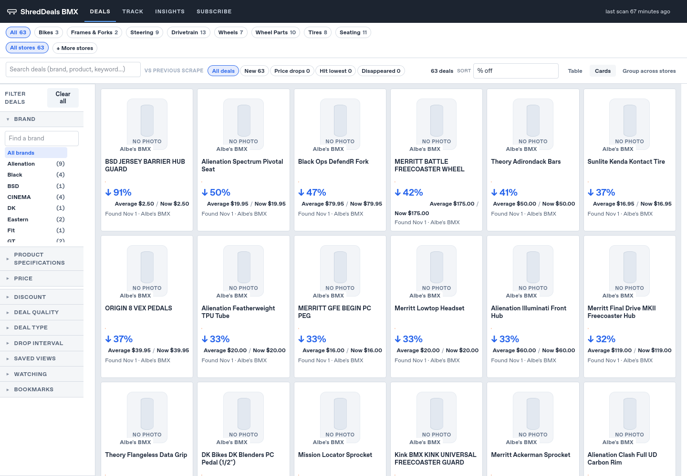
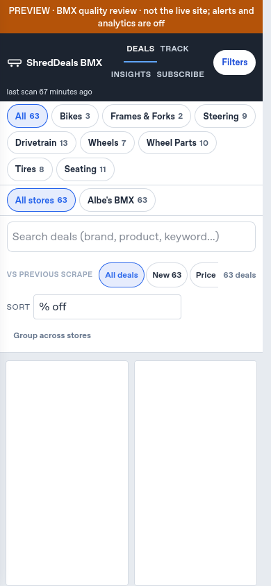

# Issue #123: BMX catalog filtering and data quality

Review branch: `codex/bmx-catalog-quality`. This follow-up reuses #124's Albe's
Shopify adapter and sport renderer. It is independent of the unified-header and
Claude brand-extraction work. It does not change the shared Shopify parser,
branding, page UI, scoring, price calculations, root HTML or production data.
No production scrape, email, merge or deployment is performed.

## Real snapshot before / after

Source: [Actions preview run #1](https://github.com/pchoward/salesscraper2/actions/runs/41338783215),
commit `4a98c48fd9e50c2ec49b2b4a048e13f41c9e6028`. The normalized catalog,
price history and saved report inputs are fixtures with SHA-256 provenance.
They are real saved data; the separate `synthetic-variants.json` explicitly tests
possible feed edge cases and is not claimed to be an Albe's raw feed capture.

| Albe's category | Before | After |
|---|---:|---:|
| Bikes | 6 | 3 |
| Frames & Forks | 4 | 2 |
| Steering | 9 | 9 |
| Drivetrain | 13 | 13 |
| Wheels | 10 | 7 |
| Wheel Parts | 11 | 10 |
| Tires | 8 | 8 |
| Seating | 11 | 11 |
| Braking | 0 | 0 |
| Total unique listing URLs | 72 | 63 |

Nine explicit mismatches are removed: the electric bike, 26/27.5-inch bikes,
24-inch fork, 26-inch frame/fork kit, 16-inch wheelset, two 18-inch wheels and
29-inch rim. The initial policy targets **20/22-inch compatibility**. Smaller
freestyle bikes can be valid products; this is a deliberately limited first
catalog, not a claim they are not freestyle. Universal parts and listings with
unknown fit remain, with unknown fields omitted. No street/park/transition
segmentation is introduced.

Explicit BMX race-only labels are rejected. **SE RACING** in a brand/model alone
is not evidence of race-only use, so the Narler Retro stem is not guessed away.
Top-tube length, bar rise, axle diameter and wheel diameter are separate fields.
A 20.75-inch top tube or 9-inch bar rise is not a wheel size.

## What specifications are actually available

Only **3 of the retained 63** saved listings have an exact, unambiguous wheel
measurement in the normalized title: two 20-inch listings and one 22-inch listing.
The other **60** have no verified fit spec in this snapshot. The saved run did not
retain source variant options/descriptions, so none is reconstructed from model
names, images, filename tokens, similar products or standard bike assumptions.
There are no verified top-tube, bar-rise, crank-length or axle values in this
saved sample.

For future normal feed reads, `BmxShopifyScraper` layers on the existing parser
without extra requests. Explicit named, unit-bearing variant options or labeled
manufacturer specs populate `bmx_specs`: wheel size and top-tube/bar-rise values
in inches, crank length and axle diameter in mm. Bare/ambiguous dimensions,
ranges, conflicting values and unverified conversions are withheld. The parser
accepts 20 and 22 separately; it never expands a range into claimed inventory.

`bmx_offers` retains each eligible sale variant's ID, exact price, compare-at,
known/unknown availability and specs. Unsupported-size or explicitly sold-out
variants cannot supply the listing's cheapest price. Multiple eligible variants
still produce **one product URL/card**, preserving existing identity. Unknown
stock remains **Check store**; only an explicit true flag permits an individual
offer to say In stock. A minor malformed/conflicting spec is nonfatal: the listing
remains, its affected specs are unknown, and the warning is kept internally.

These fields are data contracts for a later sport-spec UI integration. This PR
does not add or imply working new facet controls in the existing page/search UI.

## Price evidence, without invented history

All 63 retained rows have only **one observed price** in the captured history.
They have retailer compare-at markdowns and **zero observed price drops**.
`price_basis = retailer_compare_at` records the source; the offline audit reports
retailer markdown and prior observed sale price separately. Coupon/BOGO wording
does not create another discount or a historical observation. Synthetic tests
prove that a compare-at discount alone does not count as a historical drop, while
two real recorded sale prices can establish one.

The existing cards' **Average / Now** wording can show equal values beside a
retailer markdown. That is a separate renderer presentation issue, documented
rather than fixed by changing history or copying UI logic. Coordinate that
wording with Claude's current page/header integration.

## History/lifecycle integration — small engine seam for Claude review

The primary logic lives in new `sports/bmx/quality.py`, `catalog.py` and `audit.py`.
`sports/bmx/stores.py` changes only the parser factory/import; `sports/rules.py`
delegates its BMX rule to the new scope check. Claude's shared Shopify brand
extraction and aliases stay untouched.

A few shared integration lines are essential to preserve existing history:

- `history.py` recognizes an explicit `catalog scope: ` exclusion, retains its
  price observations under the existing retention policy, and skips miss/stage
  updates and Recently gone for intentional exclusions. An optional private
  `catalog_scope_reason` preserves variant-only evidence that an old title lacks.
  Historical files without this field keep their original behavior. A returning
  eligible listing clears the marker. No URL, name, price series or low is reset.
- `scraper.py` collects only successful adapters' explicit exclusion evidence and
  passes it to miss tracking and catalog diffs. Failed/suspicious keys cannot add
  exclusion evidence. Health/completeness assessment still happens normally.
- `report.compare_catalogs` accepts optional `excluded_urls` to suppress false
  removal events for intentional scope changes. Its existing pricing/diff rules
  and all callers without this option retain their behavior.

These are opt-in seams, not an engine rewrite. Existing Skate rules never emit
this marker, and other retailers still use their existing parser. Tests exercise
normal filtering, variant-only exclusions, repeated scans, recovery, mature
partial-drop detection and full failures. Source price/history/state files are
not migrated or written by the development preview. The private marker and audit
report are not embedded into public HTML/chart data.

## Working preview and screenshots

```bash
python -m previews.bmx_quality --output-dir /tmp/bmx-quality-review
python -m http.server 8000 --directory /tmp/bmx-quality-review/site
```

Open the served `index.html?sport=bmx` or `bmx/sale_items_chart.html`. The builder
prints the exact absolute HTML path. Use a new output directory each time. The
bundle includes unchanged saved Skate content plus the filtered BMX page,
original charts and existing controls. It uses the existing frame shell until
the separately reviewed unified-header integration lands; no competing header
implementation is added here.

The scan stays **November 1, 2026, 1:52:07 PM Eastern**. Alerts/analytics are off,
form/remote delivery requests are blocked, and no scraper/notification engine
runs. A preview-only banner stays in normal flow so it cannot cover original
mobile drawer controls. `quality-audit.json` sits **outside `site/`** for internal
review; serve only `site/`. No operational report is added to the public UI.

Retailer image hosts are blocked in this execution environment, so local browser
screenshots may show the existing No photo fallback. Image URLs are unchanged.
The real Actions run already demonstrated that those URLs can display images.





## Validation and remaining work

```bash
python -m unittest test_bmx_quality test_history test_pipeline test_sports test_report_extras
python -m previews.check_bmx_quality --preview-dir /tmp/bmx-quality-review \
  --screenshots /tmp/bmx-quality-shots \
  --firefox /path/to/firefox --geckodriver /path/to/geckodriver
```

The browser checks use true 1440x1000 and 390x844 viewports and physical clicks.
They exercise pagination through all 63 cards, scope exclusions, retailer links,
search, sorting, Insights/Deals, offline Subscribe, history loading, Quick View
and Back, the mobile drawer and separation from Skate. This is saved-data review,
not verification of a new live feed or its terms.

This PR is a scoped #123 follow-up, not a claim that the entire issue is complete.
Remaining: real raw-variant/spec evidence via Actions (to extend precise coverage),
retailer access-policy evidence, the agreed native-header integration, and pricing
wording. A separate reviewed Actions run can later validate the combined branch;
no workflow or production deployment is triggered here.
