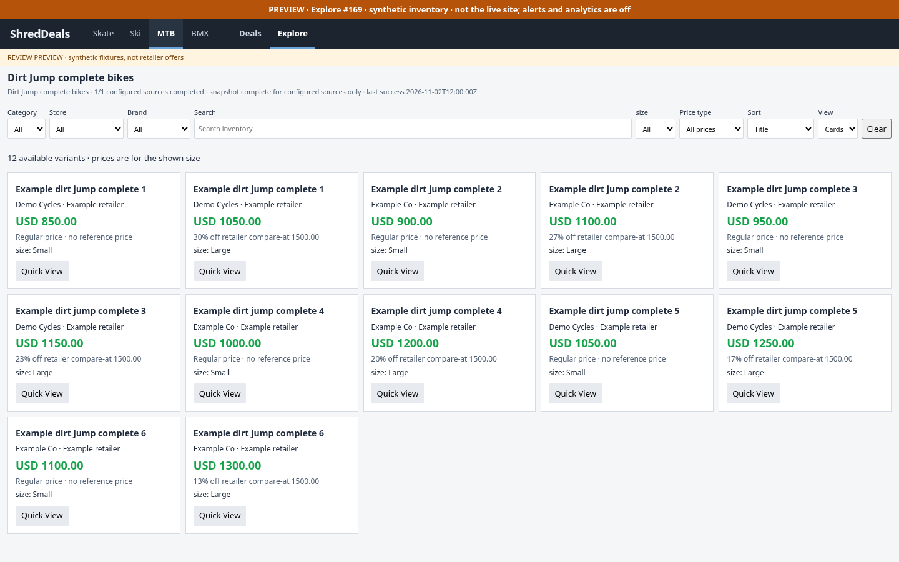
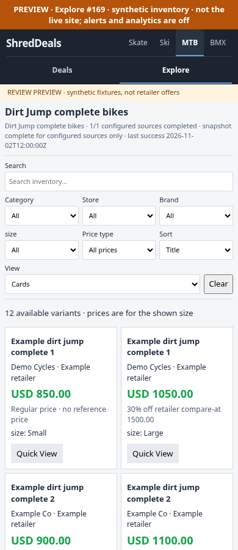

# Explore #169 review evidence — 2026-11-02

Implements the inventory boundary approved in research PR #168. This branch does
not close the **live coverage/production rollout** portion of #169: source access
and retailer permission/taxonomy verification remain blocked. No scraping,
normalization, retailer-expansion, alert, or scheduled workflow code was changed.
The default production shell still opens Deals; Explore appears only in an
explicit review build.

## Results

| Area | Result | Evidence |
| --- | --- | --- |
| Independent full-price + sale inventory | Pass | 19 new unit/navigation tests; unchanged Deals sale gate regression |
| Variant stock, selected price and history | Pass | Sold-out/unknown stock excluded; compare-at never historical; exact variant identity/spec filtering |
| Failure recovery and completeness | Pass | Missing/malformed pages, repeated IDs and page caps retain last good snapshot; verified empty supported |
| Configurable second sport | Pass | Same collector and renderer run MTB complete-bike and Ski park fixtures |
| Explore desktop/tablet/mobile | Pass | 8 sport/viewport runs at 1440, 768, 430, 390px; filters, zero results, Back/Forward, Quick View, links, Cards/Table, sport changes, overflow |
| Existing four-sport UI | Pass | All 166 existing audit checks; `four-sport-results.json` |
| Supported Python/embedded JS suite | Pass with limitation | 707 discovered: 698 passed, 9 legacy Chrome cases explicitly skipped by local runner; see below |
| Public asset synchronization | Pass | Existing publication tests; navigation source/public copies equal; default shell generation unchanged |
| Live candidate retailer access | Blocked | Six robots requests failed at environment proxy CONNECT with 403; no retailer page/feed was reached |
| Live complete-bike counts/stock/latency | Unverified | No live coverage numbers or inventory completeness claims |
| Production rollout | Off | No scheduled ingestion, production Explore link, merge or deployment |

The full suite initially failed because sandbox socket access was denied and
`google-chrome` was unavailable by that name. Local mock-server tests passed
outside the socket sandbox. The installed Chromium also returned no DOM to the
legacy file-URL `--dump-dom` harness, confirmed on rerun. A local in-memory test
runner skipped the 8 search UI methods and 1 slider screenshot case; this did
**not** edit tests, disable CI checks, or turn an unrestricted full run green.
The HTTP/Playwright Explore and four-sport checks ran successfully with the
installed Chromium; external requests were aborted. Firefox/WebKit were not run.
The 19 new tests and existing publication tests also passed in Python 3.11.

## Actual source investigation

All six `robots.txt` probes returned `Tunnel connection failed: 403 Forbidden`
from the cloud proxy, before retailer policy/content could be read:

| Candidate | Proposed category | Current status |
| --- | --- | --- |
| Albe's | `/collections/dirt-jump-bikes` | Disabled proposed Shopify config; taxonomy/policy/feed unverified |
| Verde | `/collections/dirt-jumpers` | Disabled proposed Shopify config; taxonomy/policy/feed unverified |
| The Path | `/collections/dirt-jump-bikes` | Disabled proposed Shopify config; taxonomy/policy/feed unverified |
| Dan's Comp | `/dirt-jump-mtb-bikes/c16114` | Candidate only; no new adapter or guessed extraction |
| Woods Room | `/collections/dj` | Candidate only; broad collection eligibility unverified |
| Mike's Bikes | Existing mountain-bike collection | Candidate only; no verified relevant Dirt Jump complete bike, not enabled |

These proposed collection URLs came from #160, not live discovery. No retailer is
approved. The scope's proposed type allowlists must be verified, not blindly
switched on. Required network hosts are `www.albes.com`, `verdebicycles.com`,
`www.thepathbikeshop.com`, `www.danscomp.com`, `woodsroombikeshop.com`, and
`mikesbikes.com`; permitting access does not establish retailer authorization.

Read-only inspection of saved catalogs found zero BMX Dirt Jump keyword matches
and two MTB matches, both **Cambria tires**, not complete bikes. They were not
used as Explore inventory. This demonstrates why keyword-only collection
classification would contaminate the pilot. Claude's Mike's/Cambria work remains
untouched.

The unapproved live CLI smoke test performed **0 requests / 0 response bytes**,
wrote an explicit stale/no-last-success manifest, and exited 1. It did not claim
success or write to Deals files.

## Fixture sizing, not live benchmarks

Each review scope has 6 synthetic products / 18 variants: 12 verified available
and 6 explicitly sold out. The 12 available variants each get a separate history.
One mocked page completes each scope. Current compact JSON is approximately
14.3 KB for MTB and 14.0 KB for Ski (including history); fixture processing is
sub-millisecond-scale and is **not** a retailer throughput estimate. There are
no real network, scrape-duration or repository-growth measurements yet.

## Screenshots

All prices, brands, retailers and products below are **synthetic fixture data**.

| Scope | Desktop | Mobile |
| --- | --- | --- |
| MTB Dirt Jump | [1440px](mtb-1440.png) | [390px](mtb-390.png) |
| Ski reuse fixture | [1440px](ski-1440.png) | [390px](ski-390.png) |

## Remaining work before live approval

1. Restore permitted network access; review retailer terms/robots and verify
   actual complete-bike taxonomy, currency/market, stock semantics and terminal
   pagination for a small approved source set.
2. Run the bounded capture against those sources; report eligible complete-bike
   counts, unknown stock, completion, request/time/byte costs and state growth.
   Do not broaden scope to frames/components or infer stock/specifications.
3. Review the real-inventory view and source coverage. The current review cards
   demonstrate per-variant prices and history; no live retailer images or
   supplemental `.js` stock verification have been validated.
4. Approve a single-writer ingestion schedule/locking arrangement and deliberate
   opt-in publication. This branch adds neither scheduling nor deployment.

See [engine contract and commands](../../../explore/README.md). GitHub API still
returns proxy `403 Forbidden`; native Git works, so the delivery uses a pushed
branch and Compare link rather than claiming a PR was created.
