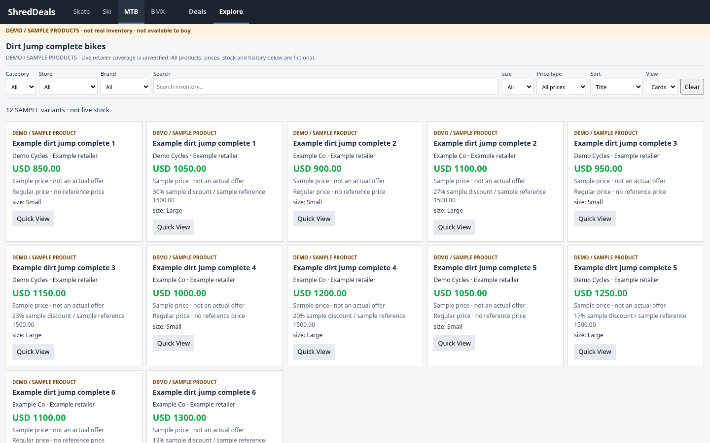
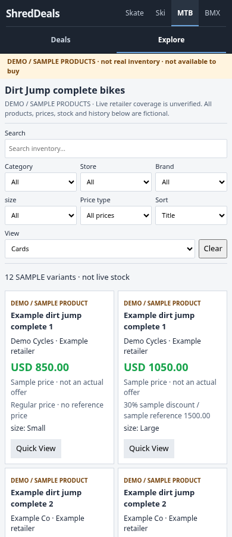

# #169 public Explore activation

Implements the owner's activation follow-up after merged #170. Publication now
includes **MTB → Explore → Dirt Jump**, with Deals remaining the landing/default.
This branch prepares public files for review/merge; it does not merge or deploy.

## Behavior

* `python -m previews.publish` deterministically builds
  `discover/mtb-dirt-jump/index.html` and `discover/view.js`, and registers only
  the MTB demo scope in the public shell configuration.
* The shared shell bridge adds the Explore entry to MTB's existing section
  navigation. No retailer-specific pages need injected scripts or persistent
  hand edits. Normal saved-data rebuilds preserve the entry.
* The main rebuild and sports-scrape workflows regenerate and stage `discover/`
  alongside the homepage/navigation. The rebuild watches `explore/**` changes.
  There is no new scraper schedule or live Explore ingestion.
* `_config.yml` continues to exclude the entire internal `explore/` directory
  and its tests. Only the two built HTML/JS files go under public `discover/`.
* The page banner, cards/table entries, Quick View and empty states clearly say
  **DEMO / SAMPLE PRODUCTS**. Prices, brands, stock and reference discounts are
  explicitly fictional. There are no sample purchase links, alerts or Watch.
* Demo coverage has no completed-source manifests, last-success claims or real
  history observations. The renderer remains variant-specific for the shown size.
* The shared sample fixture moved from the CI script into `explore/demo.py` so
  production generation does not import CI. Ski remains a fixture-only scope.

## Verification

* Public demo smoke passes at **1440, 768, 430 and 390px**, both at the site root
  and a GitHub Pages-style project subpath: 8 viewport/path runs in total.
  Checks cover default Deals, entry/return, filtering, zero results, size prices,
  Cards/Table, Quick View, Back/Forward, sport changes, no demo purchase links,
  no demo alerts/Watch, layout overflow, browser errors and failed asset requests.
* Publication tests verify deterministic rebuilds, checked-in asset freshness,
  source exclusion, exact public assets, workflow staging and symlink refusal.
* All **166** existing four-sport browser checks pass. The supported
  Python/embedded-JavaScript suite reports **714 tests, OK (9 skipped)**;
  the added artifact-size guard and publication tests also pass on a focused rerun.
  This environment's nine legacy `file:// --dump-dom` Chrome cases remain
  unsupported and were explicitly skipped locally; the CI tests are unchanged.
* Existing local Worker tests pass (5 tests; mocked network/SQLite).
* The actual built PR-preview artifact is accepted by the artifact checker.
  Its allowlist now includes only the two known demo files and the six known
  sport HTML/history files already emitted by the builder. Arbitrary source,
  scripts and symlinks remain refused. The measured four-sport preview is
  **51,469,963 bytes (~49 MiB)**, so its bounded size cap rises from 40 to 64 MiB;
  an oversized-artifact rejection test protects the cap.

No retailer requests, real price-history updates, subscriber messages, changes
to Deals sale predicates, automatic merge or deployment were performed.
Live retailer coverage remains **unverified**; real inventory is a follow-up.

## Screenshots

These show the actual generated public demo files under a project subpath,
with no separate preview deployment. All products/prices shown are samples.

[Desktop](desktop.png) · [Mobile](mobile.png)

