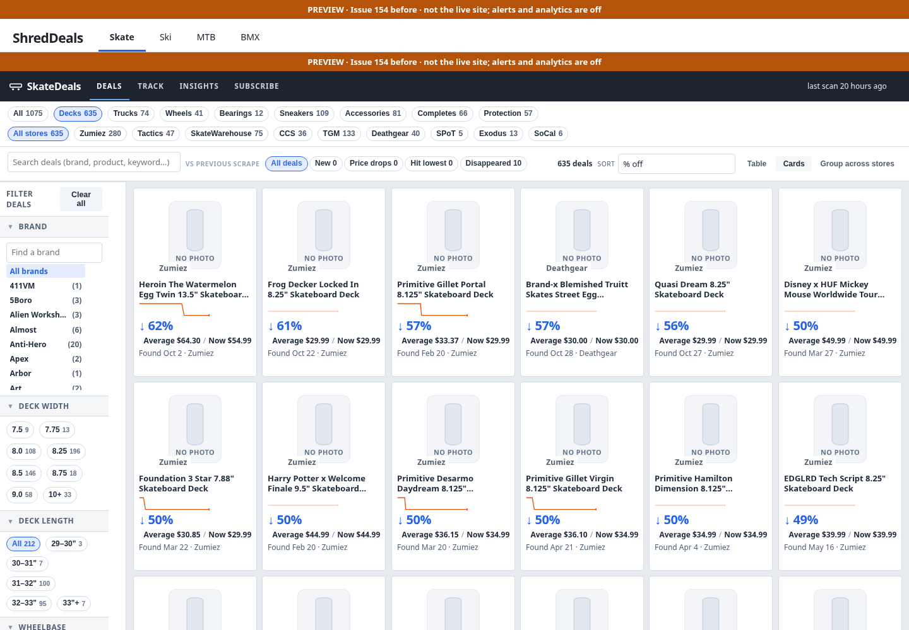
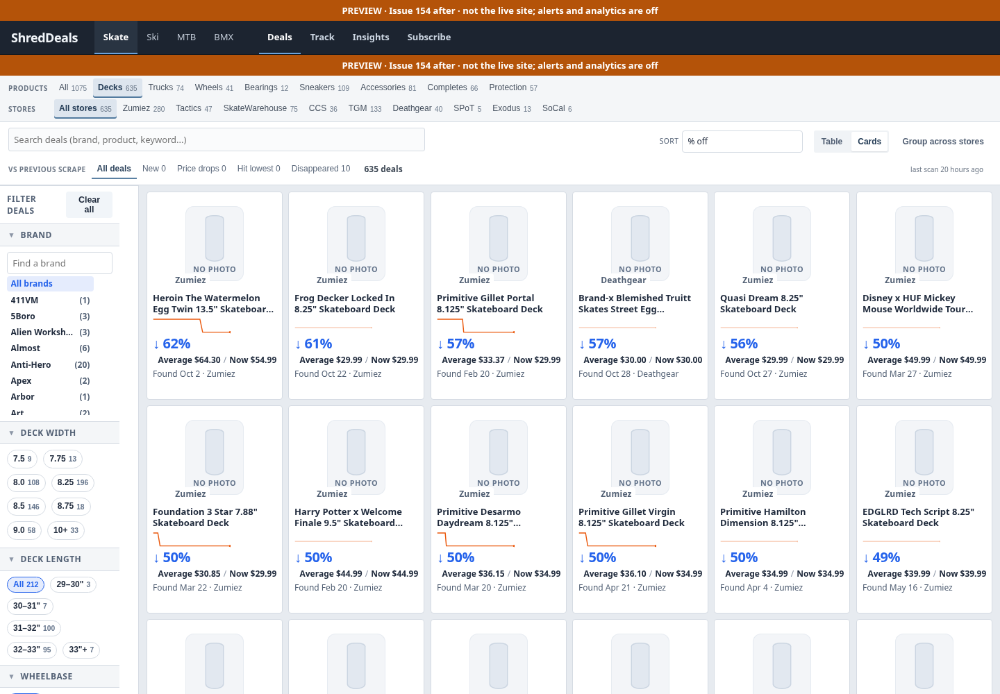
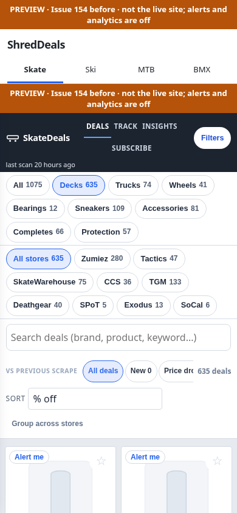
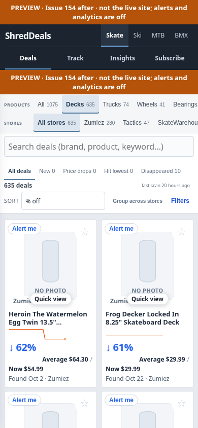

# ShredDeals top section — issue #154

The homepage uses one charcoal header for ShredDeals, sport tabs, and
Deals / Track / Insights / Subscribe. Category and retailer selectors use flat,
compact controls with a quiet selected underline. Search and display controls
share a desktop row; deal counters and scan provenance sit together below it.
On phones, category/store rows scroll horizontally and the toolbar keeps the
Filters action beside sorting and grouping.

The existing same-origin shell remains. The bridge forwards section actions to
original catalog buttons and mirrors their state; it does not copy application
logic or move handlers across documents. It removes the duplicate visible
catalog header only when embedded. Standalone catalogs retain their own header.
Original scan and Filters nodes move into the catalog toolbar. Observers are
disconnected when the catalog unloads. Dynamic category/store rendering, counts,
search, saved query/history, sport catalogs and sidebar definitions remain owned
by the original application.

No retailer modules, sport-specific sidebar fields, catalog data, notification
logic, engine configuration, or deployment workflows were changed.

## Screenshots

Both versions were built from the same saved catalog on main `28ab92c`, using
`ci/build_preview.py`. Review banners and disabled alerts are intentional.
External requests (including images) are blocked for reproducible screenshots,
so product photos use the application's existing fallback. No scrape or email
was run. Screenshot coordinates include the identical preview banners.

| View | Before | After |
| --- | --- | --- |
| Desktop, 1440 × 1000 |  |  |
| Mobile, 390 × 844 |  |  |

| Width | First card before | First card after | Recovered height |
| --- | ---: | ---: | ---: |
| 1440 | 295px | 273px | 22px |
| 1024 | 335px | 273px | 62px |
| 800 | 505px | 393px | 112px |
| 390 | 731px | 430px | 301px |
| 320 | 803px | 430px | 373px |

## Validation

```bash
python ci/build_preview.py /tmp/issue-154-after --label 'Issue 154 after'
# Set BROWSER_BINARY=/usr/bin/chromium if using the cloud image's system browser.
node ci/check_topbar.cjs /tmp/issue-154-after /tmp/issue-154-shots /path/to/before-preview
python -m pytest -q test_toolbar.py test_shreddeals.py test_shreddeals_publish.py \
  test_page_layout.py test_page_split.py test_unified_header.py \
  -k 'not caption_is_below_the_range_thumbs'
```

- 37 regression tests passed.
- The browser acceptance check passed at all five widths: one visible header,
  no overflow or overlapping section buttons, original category/store counts,
  search and URL state, Track/Deals/Insights, offline Subscribe, sort, grouping,
  desktop layout switch, mobile filter drawer, sport navigation and Back.
- All seven existing `test_search_ui.py` assertions passed with the original
  test driver rendered through Playwright over local HTTP. Its normal
  `google-chrome --dump-dom file://...` harness cannot run here: this managed
  browser blocks file URLs. The same limitation prevents the unrelated legacy
  slider-caption browser test from completing through its normal harness.
- `git diff --check` and JavaScript syntax checks passed.

The full issue body and earlier discussion screenshots were unavailable because
GitHub API access was denied by the runtime proxy. The implementation follows
the owner's detailed issue brief supplied in chat. Review screenshots before
merging; no automatic merge or deployment is requested.
