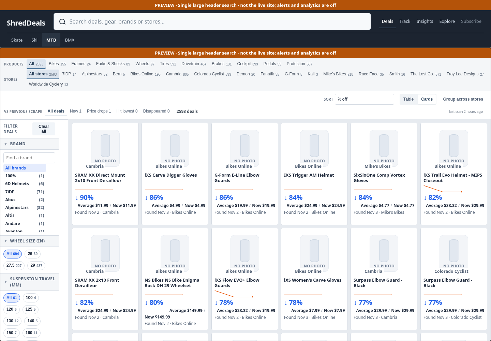
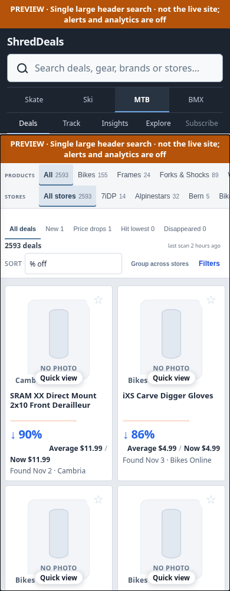

# Large primary search and a separate sport row

Focused follow-up to #199, retaining the current dark theme as an incremental
step toward the future reference. No V-Next redesign is activated.

* One large primary search: 50px tall on desktop and 48px on mobile. It fills
  the space between the branding and right-aligned section controls on desktop.
* Sport navigation occupies its own row. Existing Deals, Track, Insights,
  Explore and Subscribe actions remain available; narrow layouts stack them.
* The duplicate visible catalog search is removed when embedded in ShredDeals.
  The existing input remains an internal state/control for the unchanged search
  engine. Search chips, filters, query history and saved-search behavior remain.
* Existing autocomplete results appear below the primary input. Pointer and
  Arrow/Enter/Escape interactions delegate to the same catalog implementation;
  accessible listbox IDs and active selection live alongside the visible input.
* Direct standalone catalog links retain their original search field and
  autocomplete behavior. Explore uses the same single header input.
* CSS/JavaScript URLs are content-versioned, with a matching bridge revision,
  so new header markup does not depend on an older cached stylesheet/script.

## Verification

The enhanced header regression checks pass at 1440px and 390px across Skate,
Ski, MTB and BMX, plus Explore. They verify minimum search width, a separate
sport row, right-aligned desktop controls, hidden duplicate inputs, real filter
results, keyboard/pointer autocomplete, resets/chips, Back/Forward, category/store
preservation, empty catalogs and standalone search behavior.

Supported Python/embedded JavaScript suite: **764 tests, OK (9 skipped)**. The
nine legacy file-URL Chrome tests remain unsupported in this environment; CI
is unchanged. Focused publication/cache-versioning tests also pass. The existing
four-sport desktop/mobile browser audit also passes all **70** checks.
Public Explore checks pass at desktop, tablet, 430px and 390px.

No scraping, email, automatic merge or deployment. Screenshot image placeholders
are expected because external retailer requests are blocked during local QA.

[Desktop](desktop.png) · [Mobile](mobile.png)

