# Multiple store selections

Choose any number of stores by tapping their names in the store row, or using the checkbox-style toggles in Filters. Selecting CCS and Tactics shows deals from either retailer. Category, brand, technical specifications, search and price still narrow the selection. Tap a selected store again, remove its individual chip, or choose **All stores** to reset this facet.

The existing `store` URL parameter now accepts comma-separated slugs, for example `store=ccs%2Ctactics`. Single-store bookmarks retain their meaning and serialization. Saved views still contain the same query string field, and localStorage keys are unchanged. Store counts ignore the store selection itself while respecting other filters; selected stores remain removable when they have zero matches.

This change builds on the separate phone filter history fix. It changes UI filtering and generated presentation only; scraping, retailer data and dependencies are unchanged.

## Verification

- Four real saved catalogs at 1440px desktop, 390×844 and 320×640 phones.
- Two-store union, individual and combined counts, keyboard toggling and the top store row.
- Reload/bookmarks, saved-view round trips using the existing storage shape, individual removal, Back and Forward.
- Category, brand, price and search combinations; technical picks preserve the store selection and cannot expand the other filters' results.
- Empty results keep selected stores and All stores accessible; Clear all and legacy single-store bookmarks retain their prior behavior.
- Existing header-search browser checks and the Python/embedded JavaScript regression suite.

## Screenshots

Before uses the single-store implementation; after selects two stores. Both use the same saved catalog inputs. External image requests are blocked consistently in the review browser, so product image placeholders are expected.

| Sport / viewport | Before | After |
| --- | --- | --- |
| Skate · phone | 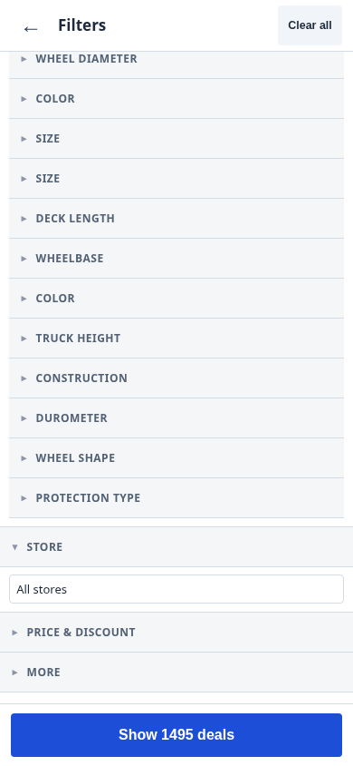 | 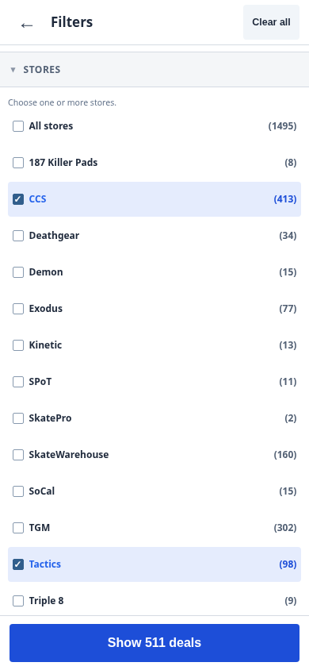 |
| BMX · phone | 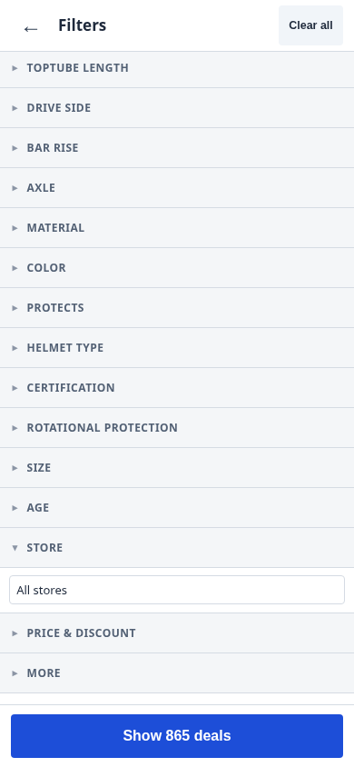 | 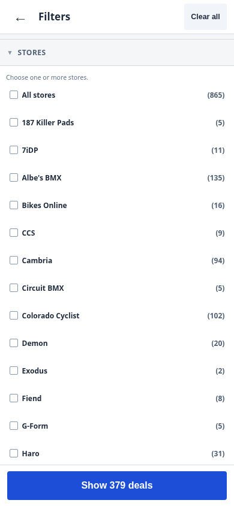 |
| Ski · phone | 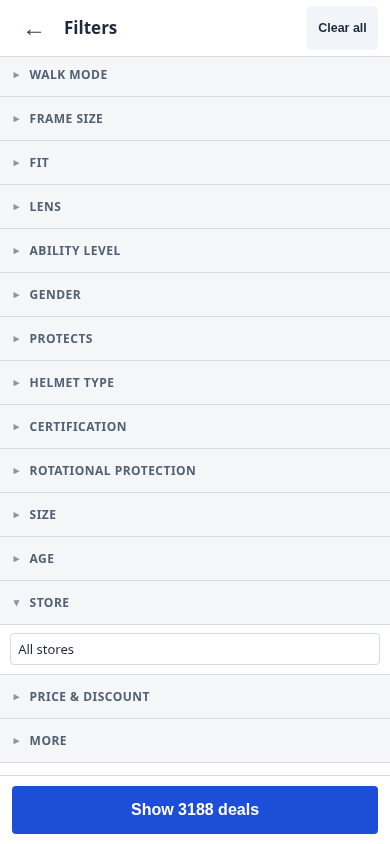 | 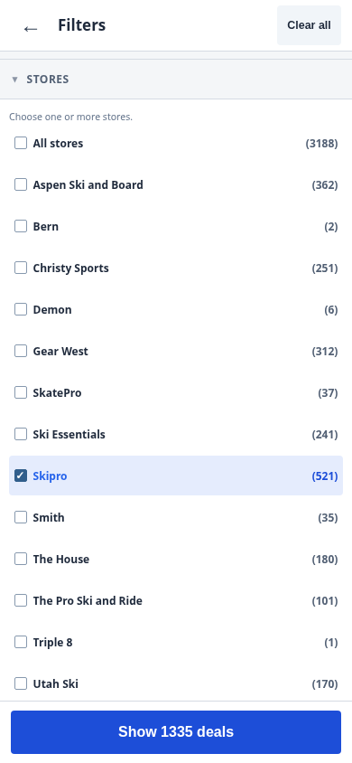 |
| MTB · phone | 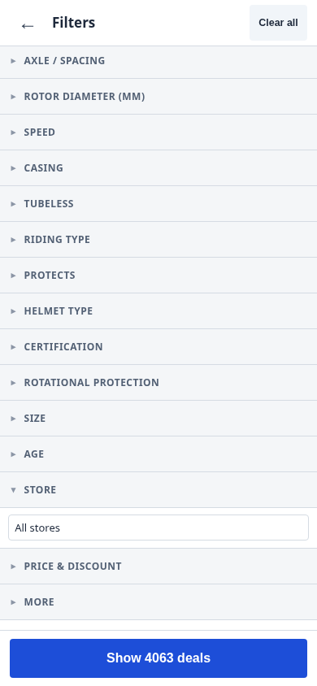 | 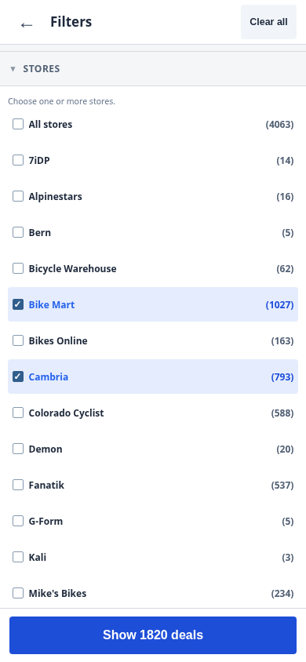 |
| Skate · desktop | 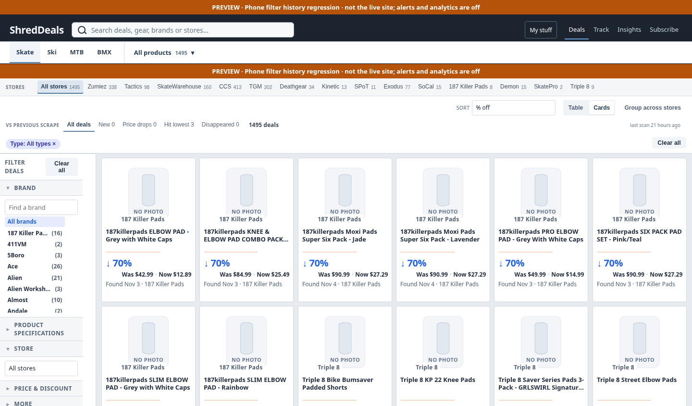 | 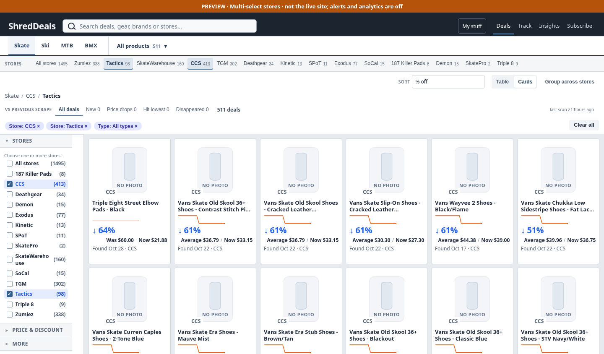 |
| BMX · desktop | 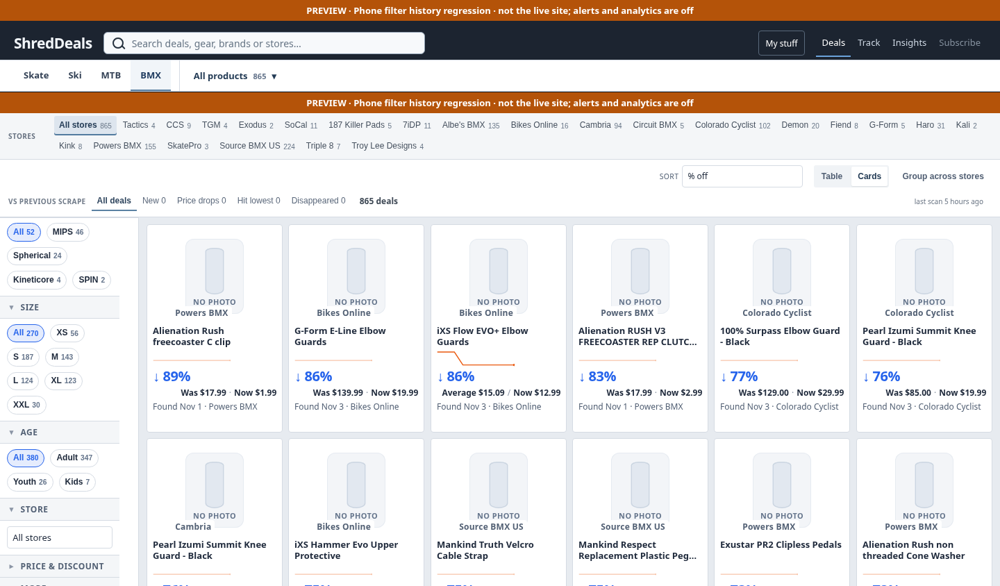 | 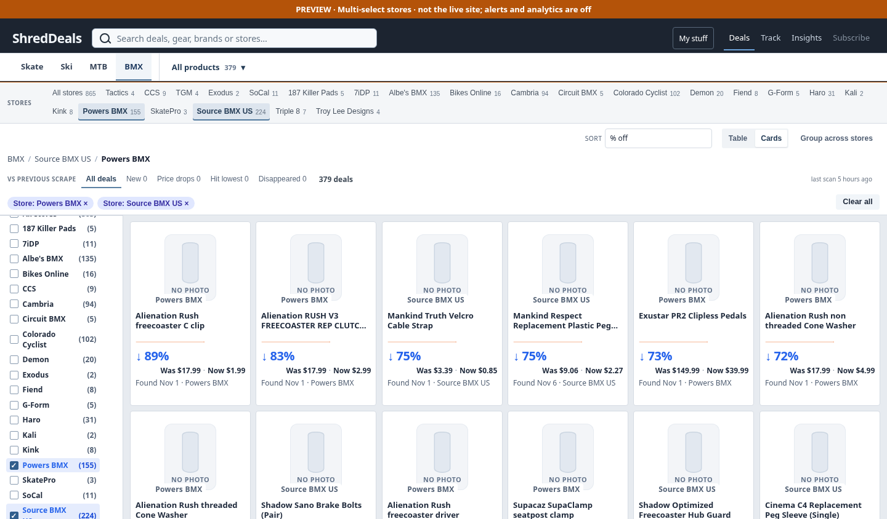 |
| Ski · desktop | 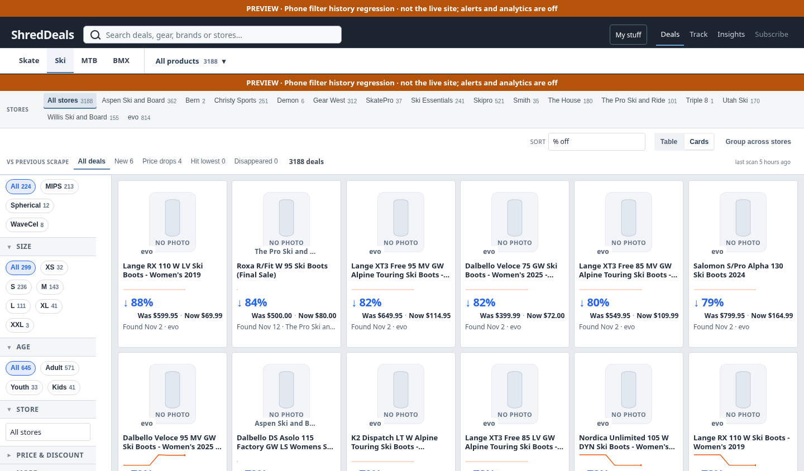 | 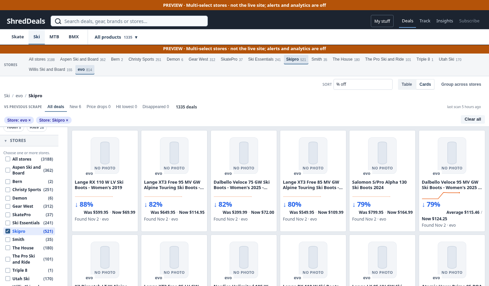 |
| MTB · desktop | 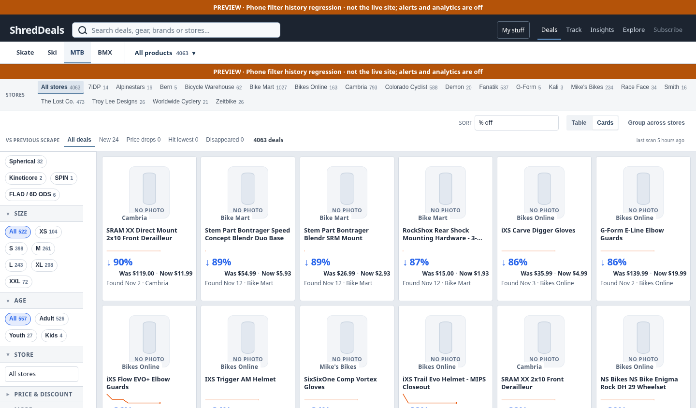 | 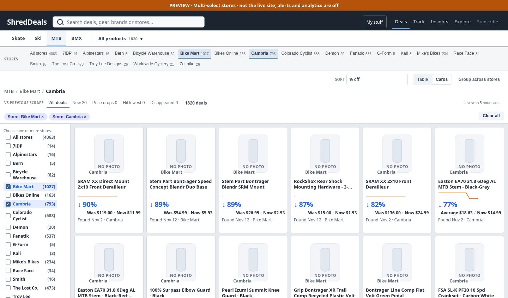 |
