# Task 11 — fresh category browsing with the phone sheet

This is the second PR, stacked after task 12. The task-11 production behavior
already shipped in **PR #256**: top-menu picks reset all catalog filters, menu
counts show full catalog totals, and incompatible dimensions stay in old URLs
without appearing as active chips or breadcrumbs. This follow-up preserves that
implementation and adds real phone-sheet interaction coverage and screenshots;
it does not manufacture a duplicate production fix.

## Added checks

`ci/check_category_navigation.cjs` now includes 320×640 and uses 390×844 for
phone checks. On BMX it opens the task-12 sheet and selects actual Wrists and
Elbows chips, then sets brand/store/price constraints. The zero-result sheet is
closed with its Back control. A top-menu pick of Seats & Posts must clear those
constraints, show the category's full count and clean breadcrumbs, and leave
all populated menu categories enabled. Browser Back must restore the prior
Protection query/picks **without reopening a consumed sheet history entry**.

Seats → Bikes also clears the seat brand. Direct mixed legacy URLs and saved
snapshots still preserve their parameters; incompatible protection actions stay
out of the seat-clamp breadcrumbs. The existing desktop, other-sport, filtered
count, search, sidebar-category and Back/Forward checks remain in the same file.

## Before / after phone evidence

The historical before build is **`b79da37`**, before PR #256, rendered from its
own committed data. The after build includes task 12 and the existing #256 fix.
These are labeled previews, with external images blocked for repeatable layout
capture. Inventory dates/totals can differ; the comparison concerns retained
incompatible chips and filtered-versus-full category counts, not retailer growth.

The exact same mixed bookmark is used on both sides:
`?sport=bmx&type=seats-posts&bmx_protects=Wrists%2CElbows&brand=supacaz`.
Before, Wrists/Elbows decorate a seat clamp and other menu categories are
zeroed/disabled by the brand filter. After, the URL still retains those dimensions,
but the breadcrumbs omit them and the menu presents full catalog counts.

| View | Before | After |
|---|---|---|
| Mixed bookmark, 390px | 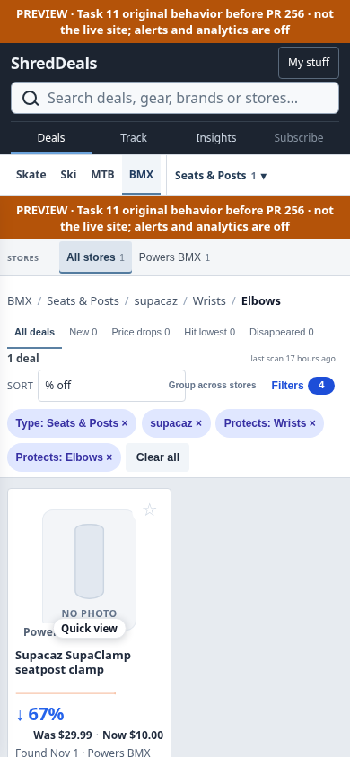 | 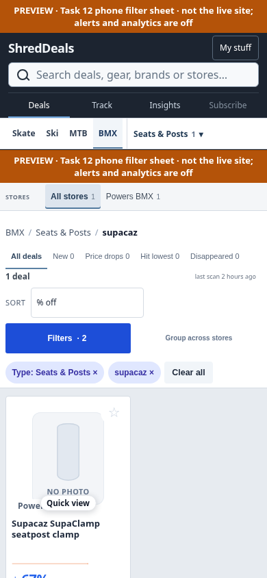 |
| Category menu, 390px | 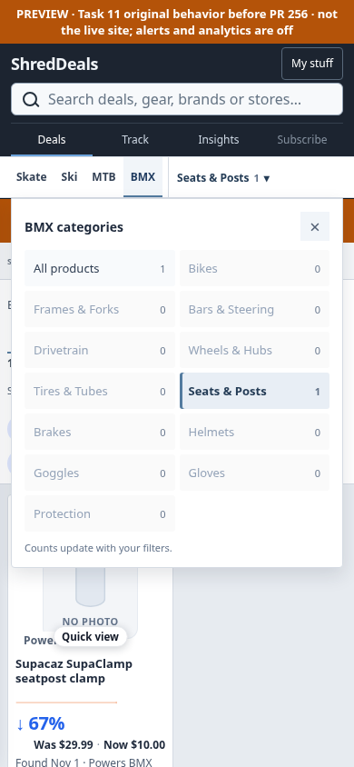 | 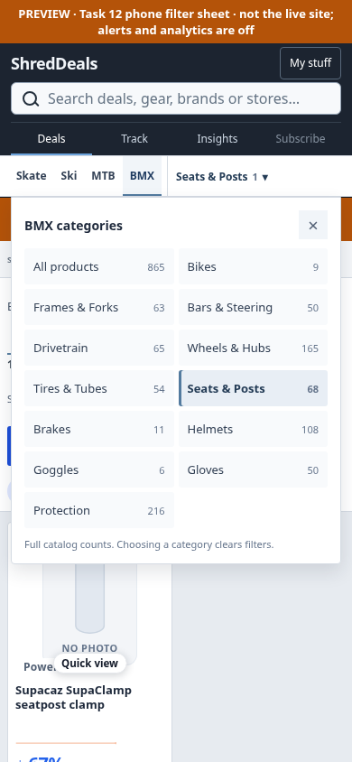 |
| Mixed bookmark, 320px | 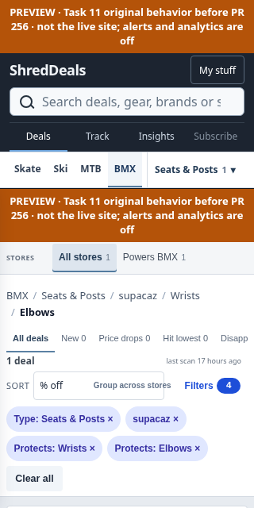 | 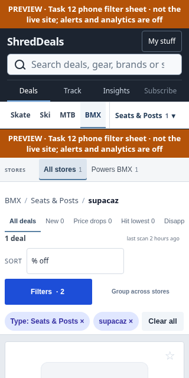 |
| Category menu, 320px | 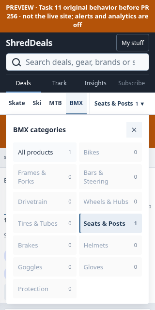 | 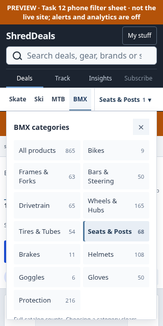 |

Fresh category navigation and Back restoration through the new sheet:

| Width | Fresh Seats & Posts | Back restores Protection |
|---|---|---|
| 390px | 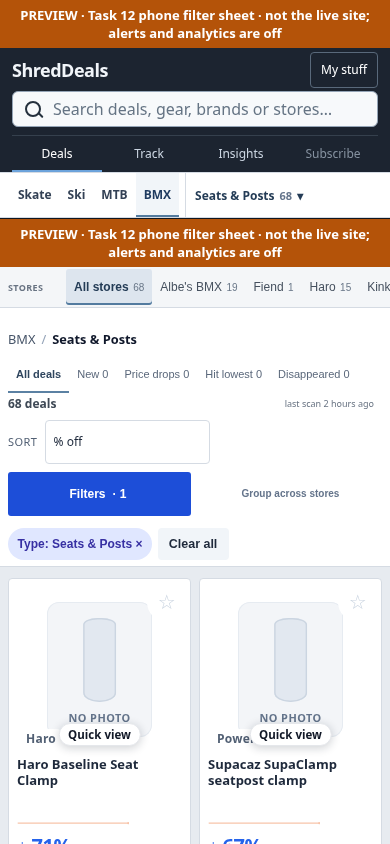 | 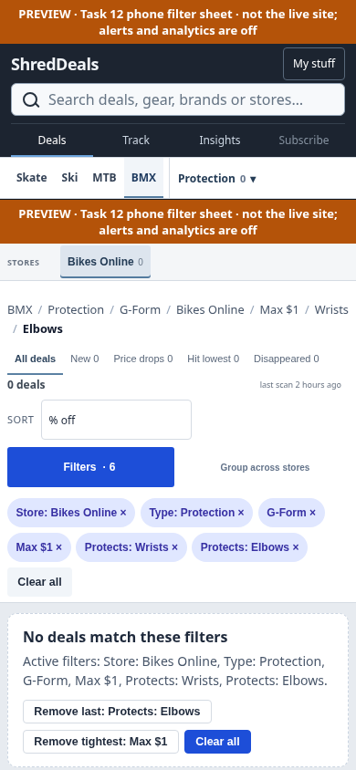 |
| 320px | 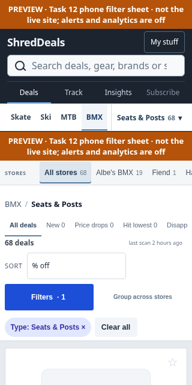 | 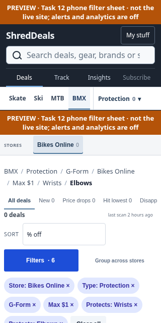 |

## Validation / scope

All four sports pass the phone category checks at 390×844 and 320×640. Task 12's
full suite passed **926 tests**, and its phone filter/desktop-preservation and
legacy sidebar checks passed. This PR's CI runs the existing Python suite and
expanded category browser matrix separately. It must remain a draft until both
GitHub PR checks are green. No URLs, saved views, storage keys, production UI,
catalog/history files, retailer adapters or workflows are changed by this PR.
