# Task 12 — phone filters

Task 12 of `docs/codex-backlog-2026-11-07.md`, implemented before the task 11
follow-up. Scope is **640px and below**; existing 641–800px tablet/landscape rules
and desktop layout remain unchanged. Optional item 6 (trimming rows above the
cards) is **not included**.

The phone sheet covers the shared header as well as the catalog. Its fixed
header offers Back, Filters and Clear all; a separate scrolling body keeps the
live Show N deals button within thumb reach. Zero results disable the button
and show a recovery hint. Filters still apply through the existing controller.
Closing the sheet consumes its temporary history entry without undoing live
picks or changing URL parameter names. Browser Back closes the sheet first.
Standalone catalog pages use the same behavior.

Brand search/counts are retained. The phone view ranks the top eight by live
count; More brands expands the rest, and a selected brand stays visible. No
new localStorage keys are added; existing saved views keep their object shape.
Initial sections open to the first two plus sections with active selections.
Controls remain collapsible and chip targets are at least 44px.

Sort and Group across stores occupy separate rows at phone widths. One prominent
Filters button retains the active count. Card names use three lines on phones,
with their full name as the retailer link title and accessible text; desktop
remains at its existing two-line clamp.

## Before / after (390×844, same saved catalogs)

External image requests are blocked for repeatable layout checks. Results and
initial open-sheet comparisons use the same category/filter state.

| View | Before | After |
|---|---|---|
| Skate → Wheels results | 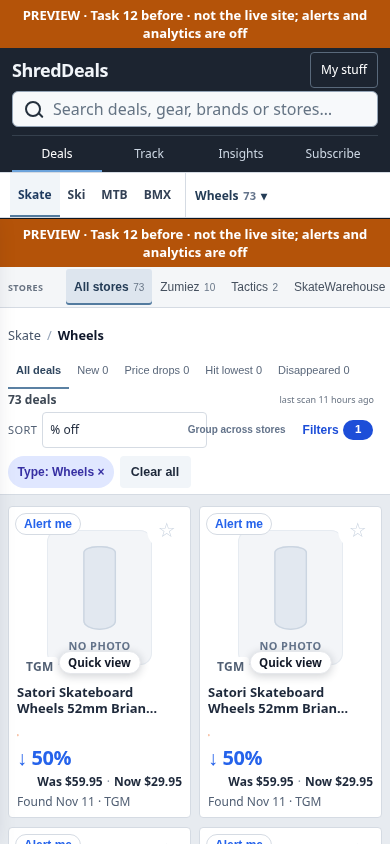 | 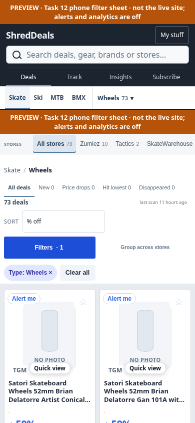 |
| Skate → Wheels filters | 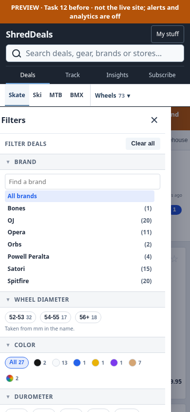 | 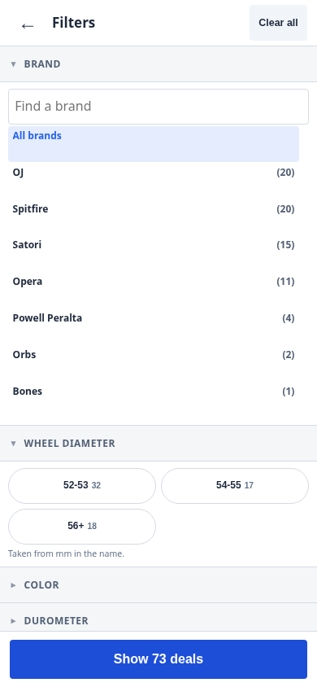 |
| BMX → Bikes results | 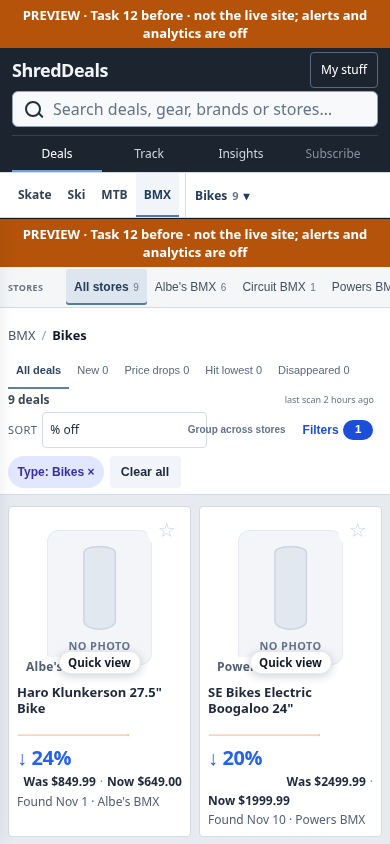 | 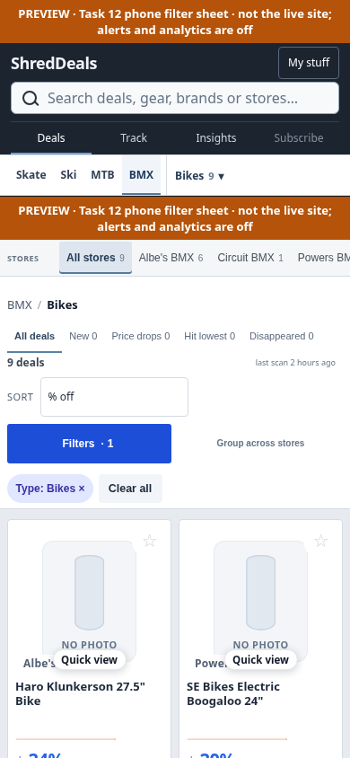 |
| BMX → Bikes filters |  | 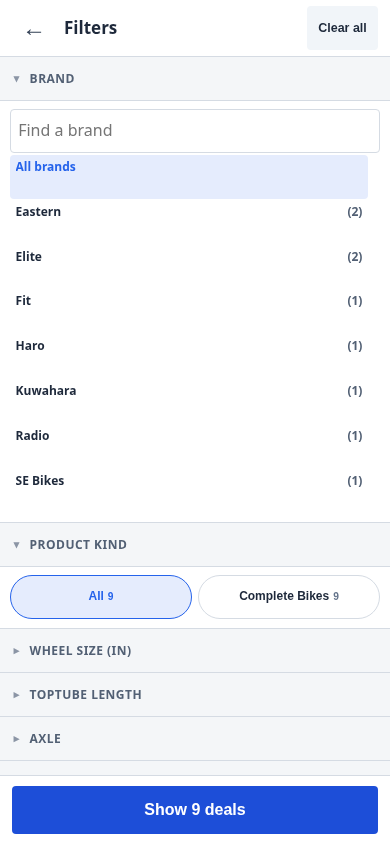 |
| Ski → Skis results | 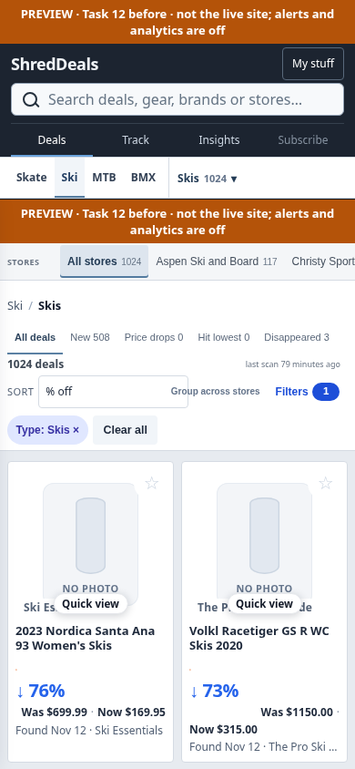 | 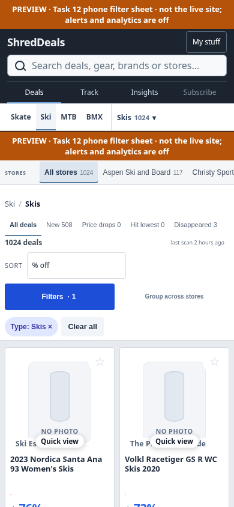 |
| Ski → Skis filters | 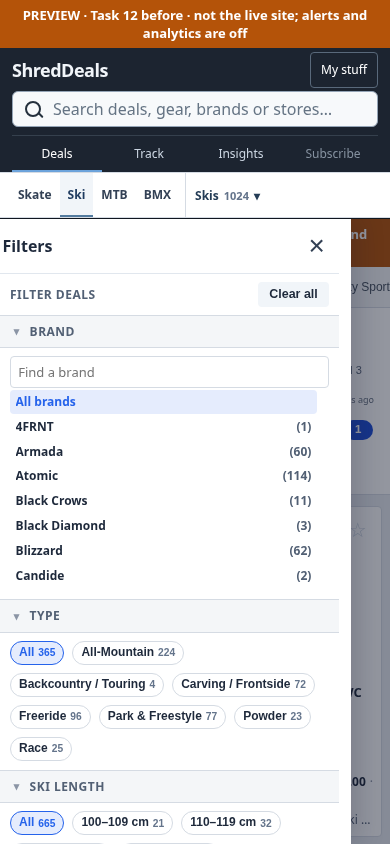 | 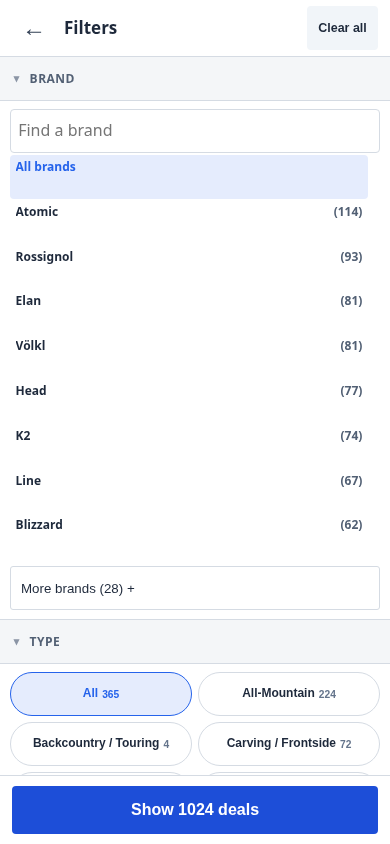 |
| MTB → Suspension results | 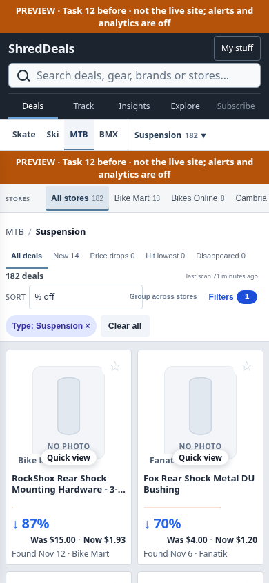 | 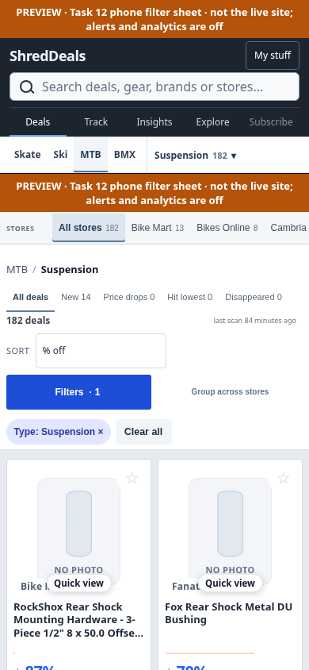 |
| MTB → Suspension filters | 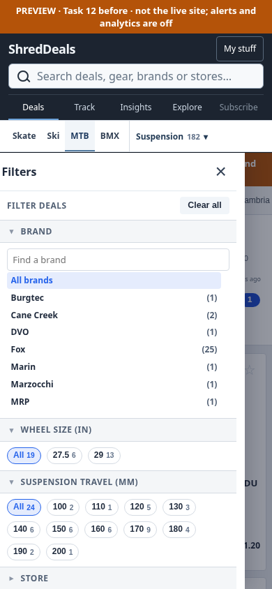 | 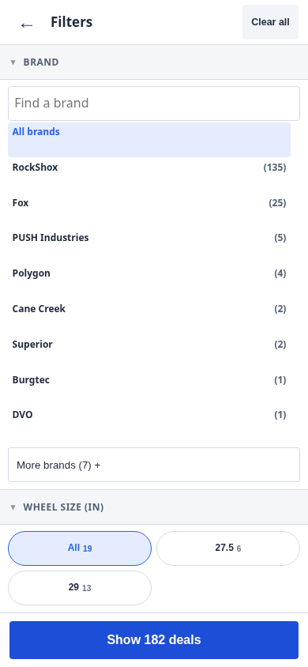 |

## Verification

`ci/check_phone_filters.cjs` uses the existing Playwright and local preview
server. It checks all four sports at 390×844 and 320×640: sort/group bounds,
full-screen frame/sheet bounds, frozen background, modal state, initial sections,
brand selection/More/search, live/zero results, Show closes, browser Back retains
the current view, 44px chips and actual three-line card names. It also checks
standalone Back handling. Local before/after geometry comparisons cover all
four sports at 1440px; desktop stays unchanged. Chromium emulation is used,
not a claim of testing a physical iPhone.

The existing sidebar/saved-query checks also run. The new controller is inlined,
kept out of public source listings, and included in the normal saved-data UI
rebuild trigger. No scraper, stored product/history data, subscriber delivery
or production rollout changes are included. GitHub checks must be green before
marking the PR ready.
