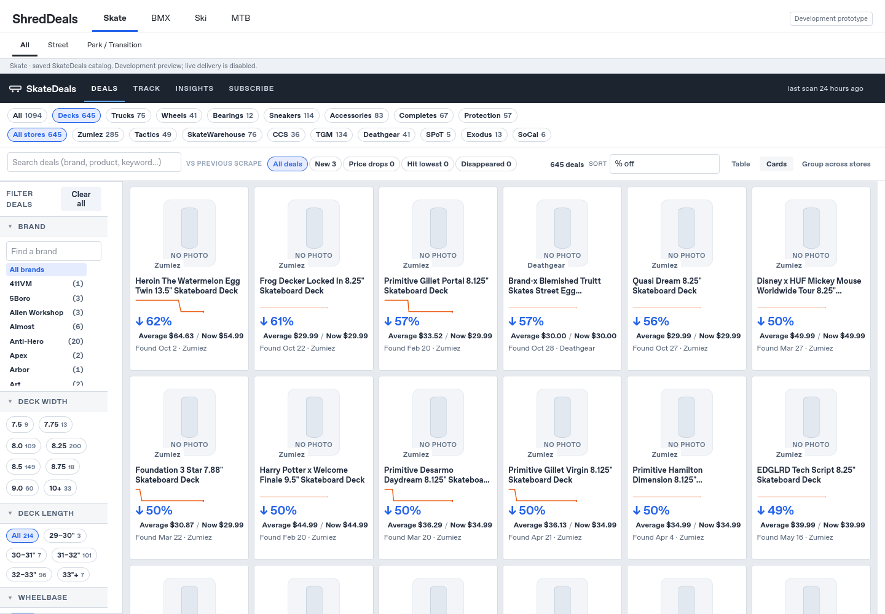
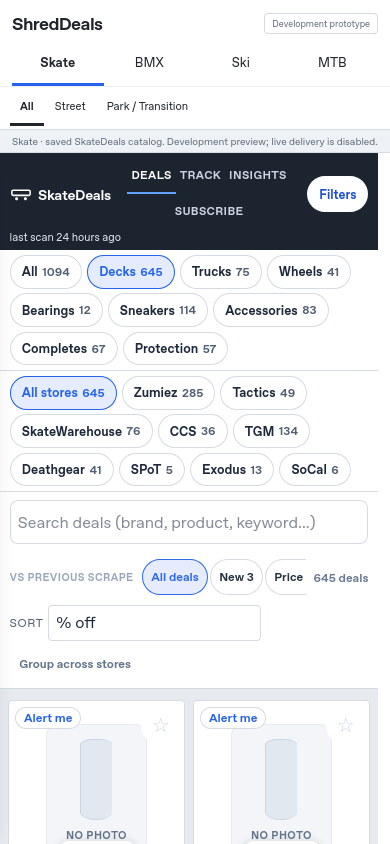
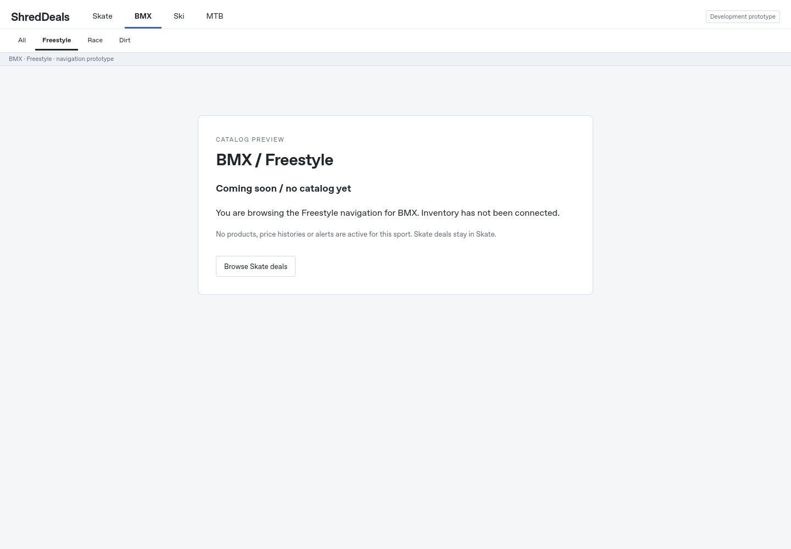
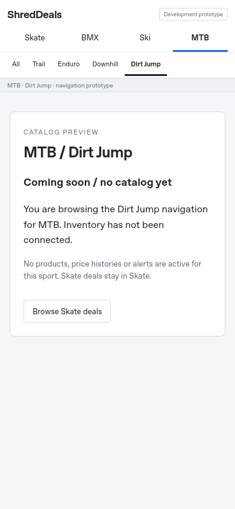

# Issue #111: ShredDeals navigation prototype

## Audit before implementation

Base: latest main `4979926` (after Claude's search PR #110). Product specification
work is on `codex/product-specification-coverage`, not a dependency of this branch.
The full issue was read from its GitHub issue page on November 1, 2026.

The current site uses generated HTML with inline vanilla JavaScript/CSS and
`history.json` loaded on demand. `page.py` builds the page; `page.js` owns filters,
sorting, Quick View, URL state, and alerts UI; `search/` supplies the existing search
engine and aliases. Product data and price history are already decoupled from
navigation, but category names/facets, search vocabulary, and filtering semantics
are skate-specific. There is no existing sport or discipline tag on products.

The sidebar already places Brand first, before `contextSpecs` (the current type's
size/dimension facets). No sidebar reordering or duplicate filter implementation
is needed. Existing retailer-first links, hover Quick View, dense cards, search,
alerts controls, saved views, and charts should execute their original code.

Minimal configuration: brand name/domain, default sport, and a sports array with
IDs, labels, discipline IDs/labels, catalog availability, category names, and facet
ordering. Other sports have empty categories/facets and no catalog. This is
navigation/capability configuration, not a new product schema. Both tab rows are
rendered from it. Category/facet descriptors document the existing Skate contract;
they do not reimplement or override the existing filter code.

## Chosen isolation boundary

Build a local navigation shell around an iframe containing a copy of the existing
generated SkateDeals page plus its public chart data. The iframe preserves the
production UI's own viewport, scrolling, sticky controls, hover rules, and code.
There is no cloned card/filter/search renderer. The source report, catalog,
history, scrapers, delivery code, daily workflow and production links stay intact.

Only the local copy receives a history bridge and preview safety policy. External
analytics is removed, and remote API/form/frame connections are blocked. Same-origin
chart data remains available; retailer links still open normally. Other sports
hide the entire Skate iframe and show explicit Coming soon / no catalog yet text.
Skate Street/Park tabs change navigation context, but explicitly state that discipline
tagging is unavailable and the full Skate catalog is being shown. No product is
inferred to belong to a discipline.

This is a deliberate prototype boundary, not the final multi-sport rendering
architecture. Its costs are a second scroll context, a snapshot that needs
regeneration to refresh, and explicit parent/child URL synchronization. We make no
percentage claim about measured code reuse.

## URL contract and future path

The parent owns `sport` and `discipline`. Existing Skate query keys/hash remain
addressable and pass through to the embedded app. Unknown parameters must survive
navigation. Parent and child history synchronization must avoid duplicate history
entries and validate message origin/source/path. Sport changes reset discipline
to All; back/forward restores both context and Skate query state.

The first real BMX step is a separate reviewed data contract for one category
(e.g. frames and top-tube length), followed by one permitted retailer/feed adapter.
Reuse existing price/stock/health safeguards after reviewing their skate-specific
filters, category validation, and identity assumptions. Then extract a shared
catalog renderer behind a sport capability adapter rather than copying all
scrapers or frontend code. BMX model aliases, disciplines and dimensions require
actual source data; they are not supplied by this prototype. New retailers,
product schemas, scraping, alert delivery, domains/DNS/Cloudflare, and deployment
are outside this PR.

## Preview and regression evidence

Build with `python -m previews.shreddeals --output-dir /tmp/shreddeals-preview`.
The output is a standalone static **directory bundle**, not a deployed website.
Serve that directory over HTTP for iframe messaging and lazy chart data; opening
only index.html as a file is not the supported runtime. Configuration is embedded
as escaped JSON, so no remote configuration fetch or domain is required.

Automated unit checks cover the required configuration, sport/discipline URLs,
legacy query/hash preservation, unknown parameters, source/origin/path rejection,
keyboard indexing, custom branding, unsafe output paths, absent non-Skate catalogs,
production input hashes, and identical inline Skate application/style code.

`previews.check_navigation` is an opt-in real Firefox check using the existing
Selenium dependency. It verifies the live generated prototype, retailer links,
Brand-before-dimension ordering, original search/sorting/Subscribe controls,
local price-history loading, hover-capable desktop Quick View and Back, roving
focus/Arrow/Home/End keyboard behavior, discipline reset, Back/Forward, and honest
empty states. WebDriver BiDi sets true 1440×1000 and 390×844 viewports, avoiding
Firefox's minimum outer-window-width limitation. Pointer capabilities are set to
fine/hover for desktop and coarse for mobile; no product CSS is altered to stage
the screenshots. A short-height check verifies the shell header stays visible.

Desktop Skate:

Mobile Skate:

BMX placeholder:

Mobile MTB placeholder:

The screenshot browser may not load remote product photos under this environment's
network policy; these are the existing page's own no-photo placeholders, not
substituted or fabricated products. Saved catalog counts/timestamps are retained.

## Branch boundaries and risks

No `page.py`, `page.js`, CSS, search, schema, scraper, workflow, or delivery source
files are edited. Only new preview/tests/docs and README/Pages exclusions change.
This avoids editing the merged Claude search work or the separate specification
branch. Git branch names alone do not establish which other agents are actively
working. README and `_config.yml` additions may need rebasing if another branch
lands first; the application files have no direct overlap in this PR.

The snapshot builder deliberately fails if the production page starts linking
new local JavaScript/CSS dependencies: that needs a reviewed copying rule rather
than silently serving a broken preview. A production rollout would require a
separate architecture/deployment decision; the iframe prototype is not wired into
GitHub Pages, production navigation, or the daily job.

Validation for this branch: 529 Python tests ran (528 passed, 1 skipped); all 40
Worker tests passed; all seven new navigation/isolation unit tests passed. Eight
pre-existing Chrome-only browser cases remain unverified in this environment:
`google-chrome` is absent and installed Chromium emits no DOM. The separate real
Firefox acceptance check passed all five groups above, including the existing
Skate controls, exact desktop/mobile viewports, and short-height navigation.
See `docs/shreddeals-browser-results.json` for recorded results. JavaScript
syntax, Python compilation and staged whitespace checks passed. Remote CI has
not run because GitHub API access currently blocks opening the PR. Nothing is
merged or deployed.
