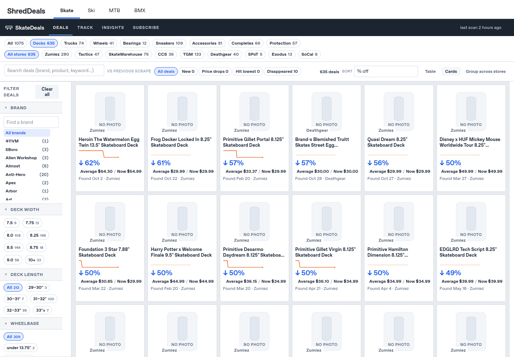
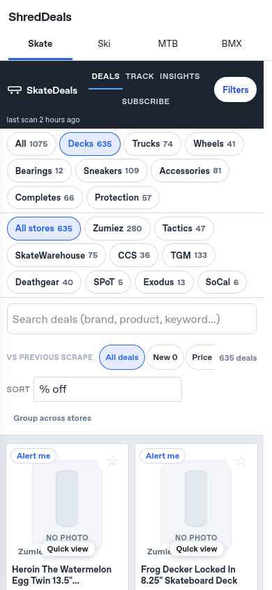

# Proposed public homepage change

This branch is for PR review only. It has not been pushed to main or deployed.
The original four-sport prototype was merged through PR #115. This follow-up
connects that shell to the live public Skate page rather than publishing a frozen
preview copy. It includes the subsequently merged specification changes (#116).

## Exact public URL behavior after the owner merges this PR

| URL | What it will show |
|---|---|
| `https://pchoward.github.io/salesscraper2/` | The ShredDeals homepage with **Skate · Ski · MTB · BMX**, Skate selected by default, and the current SkateDeals catalog/controls embedded below. No discipline row. |
| `https://pchoward.github.io/salesscraper2/?sport=skate` | The same homepage, with Skate selected explicitly. |
| `https://pchoward.github.io/salesscraper2/?sport=ski` | ShredDeals with Ski selected and an honest Coming soon / no catalog yet message. No Skate products presented as Ski. |
| `https://pchoward.github.io/salesscraper2/?sport=mtb` | The corresponding MTB empty state. |
| `https://pchoward.github.io/salesscraper2/?sport=bmx` | The corresponding BMX empty state. |
| `https://pchoward.github.io/salesscraper2/sale_items_chart.html` | The existing **standalone SkateDeals page**, with no redirect and no extra sport navigation injected into its standalone UI. Existing email links keep working. |
| `/salesscraper2/sale_items_chart.html?store=ccs&width=8.25&q=baker` | The same existing filtered Skate page. Existing query decoding, saved views, fragments, and direct retailer links are retained. |
| `/salesscraper2/?sport=skate&store=ccs&width=8.25&q=baker` | The new homepage with those existing filters applied to the embedded Skate catalog. Filter changes synchronize to the homepage URL; Back/Forward remains usable. |

The `sport` parameter belongs to the homepage; it does not redefine the meaning
of old direct Skate page URLs. Obsolete `discipline` parameters on homepage links
are removed without adding segmentation. No domain, DNS or Cloudflare changes.

## Implementation and ongoing freshness

- New `index.html` and three public assets under `navigation/` are generated
  from the reviewed preview source/config by `python -m previews.publish`.
- The public shell references `sale_items_chart.html` directly, not a copy under
  `previews/` or `skate/`. The normal daily public page stays current automatically.
- A small conditional head loader in `page.py` installs the same-origin URL
  bridge only when embedded. On a standalone Skate page it makes no bridge request
  and changes no history behavior. The bridge also rejects foreign/unrelated
  parents and handles loading after DOMContentLoaded.
- The public homepage has no development badges or claims that live delivery is
  disabled. Existing Skate alerts UI/configuration are unchanged; no delivery
  settings are enabled or disabled by this PR.
- The existing rebuild-without-scraping workflow also refreshes these public
  navigation assets when its source/config changes. It still uses the scrape
  concurrency lock and makes no retailer requests or sends any notifications.
- No scraper, catalog, price history, health checkpoint, subscriber state,
  notification state, or identity logic is changed. The regenerated public Skate
  HTML differs only by the conditional bridge loader; the saved scan date remains.

## Review preview

Generate the public assets in a local directory, copy the current public Skate
HTML and history into it, and serve the directory with a static server. The local
review bundle supplied with this change already contains those files. Its staging
copy blocks remote delivery/analytics for browser tests; those staging-only guards
are not written to production HTML. No production scrape is needed.

Original prototype architecture, keyboard/URL contract, and the future BMX path
are in [shreddeals-architecture.md](shreddeals-architecture.md).

The automated PR preview builder now opens the ShredDeals homepage instead of
redirecting to the standalone Skate page. Both preview pages are labeled PREVIEW,
noindexed, and have live alerts/analytics disabled. The artifact validator permits
only the three named navigation assets and continues rejecting unknown files and
symlinks.

Desktop and mobile review screenshots:

