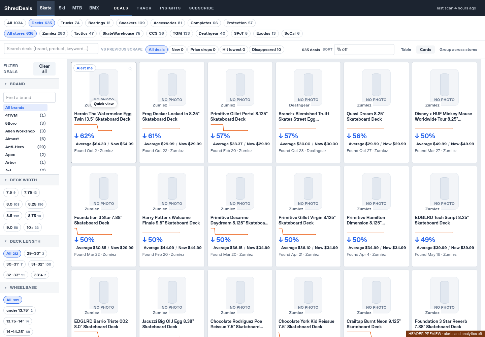
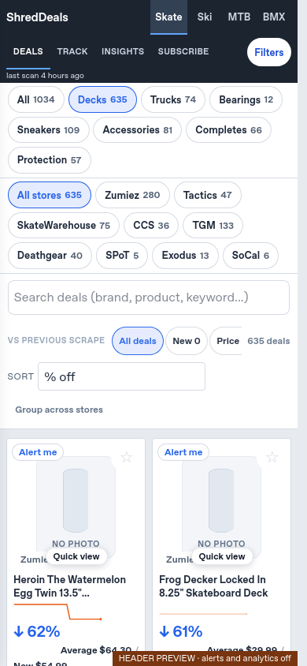
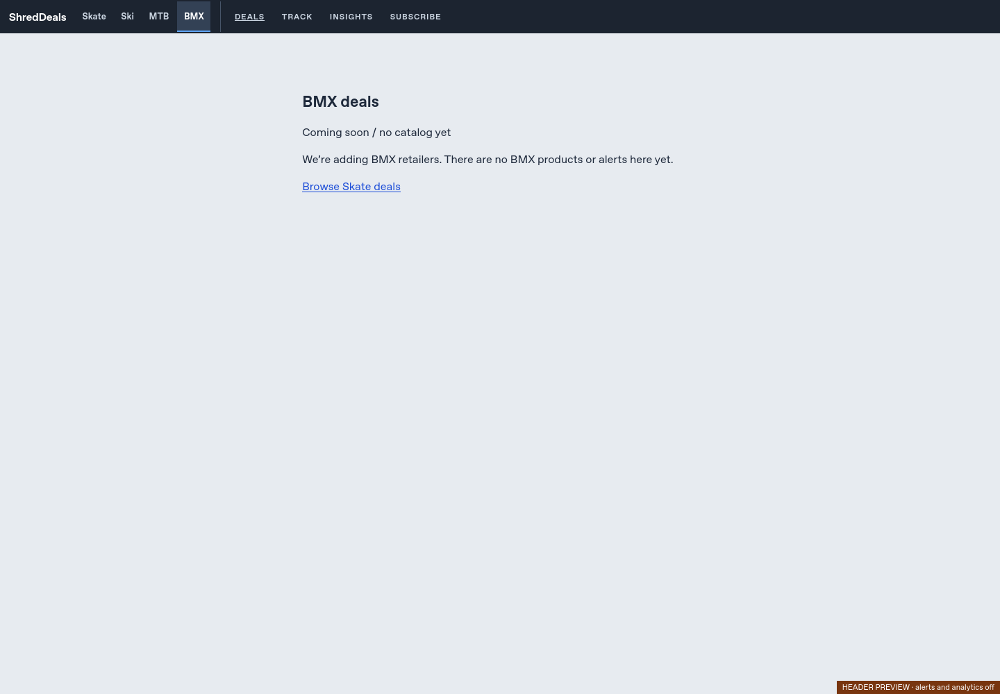

# Issue #122 — native unified ShredDeals header

This is a **review-only native-page preview and reusable header component**, based
on main `0d5b1c6` (including #119, #120 and #121). The full #122 and the #111/#115
architecture were reviewed. No live homepage, catalog, standalone page, engine,
configuration, scraper, price history, subscriber state or delivery changes.
The existing standalone preservation tag is not changed.

## Working preview

```bash
python -m previews.unified_header --output-dir /tmp/shreddeals-unified-header
python -m http.server 8000 --directory /tmp/shreddeals-unified-header
```

Open the served `index.html`. The builder prints its exact absolute file path.
Use a new output directory each time. HTTP is required for price-history loading;
opening a single HTML file via `file://` is not supported. The output is a complete
static directory containing the current saved Skate catalog/history and separate
Ski/MTB/BMX placeholder pages. Scan timestamps are copied, never refreshed.

The PR's Python test job also uploads **`unified-header-preview`**: download and
extract that artifact, then serve the extracted directory the same way. This
artifact is separate from the existing `pr-preview` artifact and its deployment
allowlist. The usual automatically hosted PR preview still shows the existing
homepage; use **unified-header-preview** to review this change. No preview hosting,
main-branch publisher/security allowlist or deployment workflow is modified.

## What works

- One charcoal header, ShredDeals brand, **Skate | Ski | MTB | BMX** alongside
  **Deals | Track | Insights | Subscribe**. Desktop fits in one 48px row at 1440px;
  mobile uses coordinated rows in the same header, with the original last scan
  and Filters action. Existing product/store chips, tools, sidebar and cards stay.
- Existing buttons and their event listeners remain the same DOM nodes; opening
  a panel or selecting the active sport does not reset search/filters. The brand
  keeps the original home/reset behavior. No duplicated Deals/alerts logic.
- Native sport-page links and browser history; **no iframe**, message bridge,
  cloned product renderer or history monkeypatch. Arrow/Home/End moves link focus;
  Enter follows the link. Tab and modified clicks retain native link behavior.
- Per-tab session storage optionally restores a sport's exact previous URL,
  including its query/hash, when returning via its link. Only configured same-origin
  paths/aliases can be restored. Back/Forward works without storage. New sports
  start with their own page URL, never another sport's filter query.
- Empty sport pages contain no Skate inventory, made-up scans or live alerts.
  Track/Insights/Subscribe are disabled until that sport has a catalog/capability.
- Review output removes the live alerts config and analytics; the original
  Subscribe panel opens in its offline Coming soon state. CSP blocks remote
  connections and form/frame submission. The production component does **not**
  disable alerts. No email/notification endpoint is exercised.

## Claude integration handoff / dependency

**Claude owns `page.py`, `page.js`, sport configuration and separate engine outputs.**
None of these files are edited here. The preview is usable now; production adoption
of this header depends on his forthcoming engine PR/output contract. It is not
safe to claim this PR alone replaces the live iframe homepage.

`previews/unified-header.js` and `.css` are the shared, framework-free component.
`previews.unified_header.inject_header(html, config)` is the small opt-in seam:

```python
from previews.unified_header import inject_header

# Use the actual output paths and labels from the engine's sport configuration.
html = inject_header(html, {
    "brand": "ShredDeals",
    "currentSport": sport_id,
    "sports": navigation_entries,
})
```

Each navigation entry has `id`, `label`, `href` and optionally `aliases` (alternate
paths for the same catalog). For example Skate may use `sale_items_chart.html`
with `./` and `index.html` aliases **only if those paths render the same catalog**.
For the preview, root/index/standalone are aliases and the placeholder URLs are
`ski.html`, `mtb.html`, `bmx.html`. These are preview choices, not requirements
imposed on Claude's final paths. URLs resolve relative to the rendered page, so
GitHub Pages project prefixes work. IDs, same-origin URLs and duplicate entries
are validated; labels are rendered as text. Adding a sport needs another config
entry and page, not a header rewrite. No category/filter/availability schema is
introduced by this component.

Integration checklist for Claude:

1. Keep the existing `#stickyBar .topnav`, `.brand #homeReset`, section buttons,
   `.topnav-links`, scan/freshness nodes and mobile Filters button. Mount once;
   source CSS goes after `page.css`/`mobile.css`. The component keeps those nodes,
   updates branding, inserts sport links, and reuses `measureBar()`.
2. Inject the header with the current sport and real page URLs after building the
   normal page. Existing app initialization remains responsible for Deals, Track,
   Insights, Subscribe, filters and history. Do not include the old outer shell or
   bridge in native pages. The preview's `inert()` helper is **not for production**.
3. Generate honest shared-header placeholders for unavailable sports. Enable
   per-sport section/subscription actions only when the engine supports them.
4. Decide the native root output and migration of existing `?sport=` homepage
   links in the engine/router PR. Keep all old `sale_items_chart.html` query links
   and identity/history behavior; no route migration is performed here.
5. Run this browser check against the native preview and engine regressions
   before owner review. Do not merge or deploy automatically.

No hardcoded iframe architecture carries into this component. Remaining compromise:
only the review builder creates placeholder scaffolding; the final renderer should
supply those empty states and page routing from Claude's configuration. Until that
integration is reviewed, the existing public two-header homepage remains unchanged.

## Validation

```bash
python -m unittest test_unified_header test_shreddeals test_shreddeals_publish test_ci_preview
python -m previews.check_unified_header --preview-dir /tmp/shreddeals-unified-header \
  --screenshots /tmp/unified-header-shots \
  --firefox /path/to/firefox --geckodriver /path/to/geckodriver
```

The real Firefox checks cover native links and Back/Forward, exact Skate filter
restoration, keyboard focus, search/sort, original section and Subscribe actions,
retailer links, history, Quick View and Back, mobile Filters, no cross-sport
products, and non-overlapping layouts at 320/360/390/768/801/900/1100/1440px.
Short mobile viewport sticky behavior is checked too. Unit tests verify safe
configuration, optional added sports, unchanged catalog/scripts/styles/timestamps,
input file hashes, inert output and unsafe output rejection.

Some retailer image hosts are unavailable in this environment; screenshots show
the existing No photo fallback rather than fabricated imagery.







Full available regression run: **571 tests completed, OK (one existing skip)**.
Eight Chrome-dependent cases could not run in this environment; the separate
Firefox native-header acceptance check passed.
